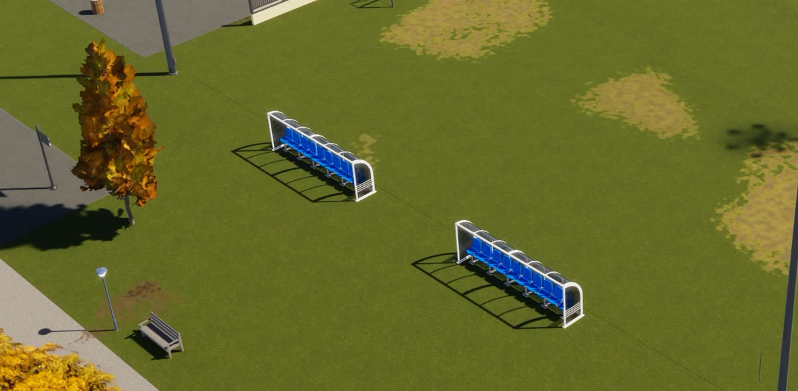
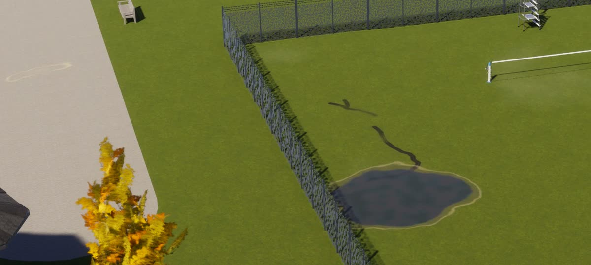
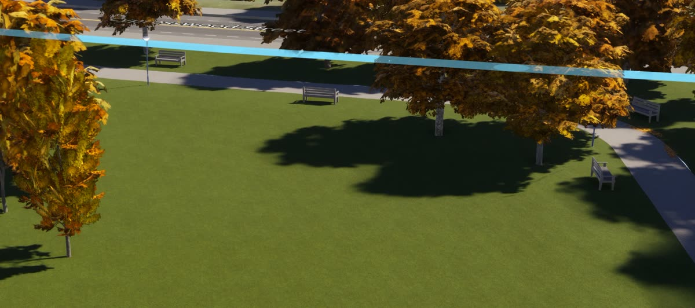
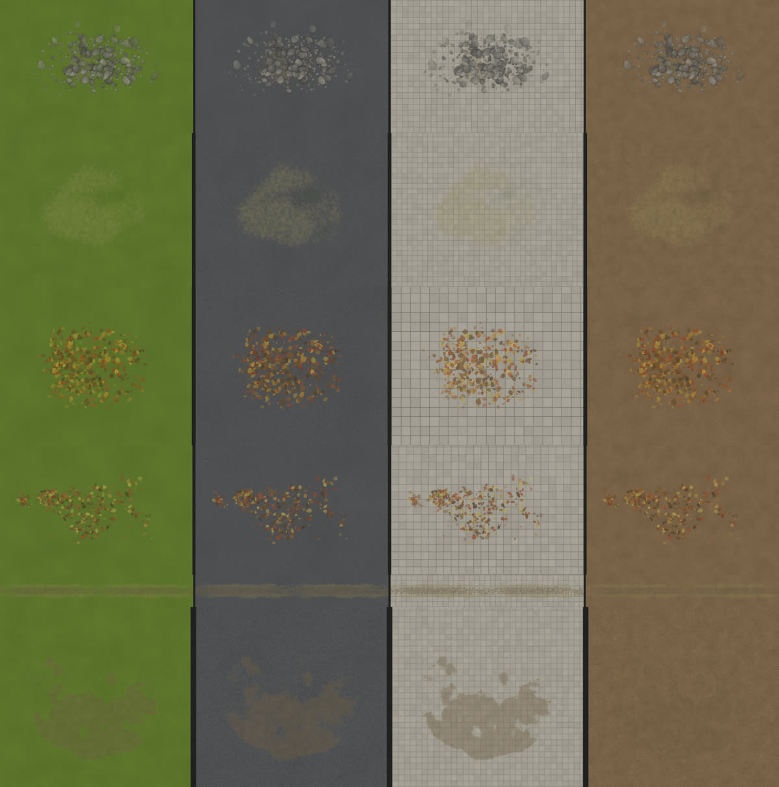
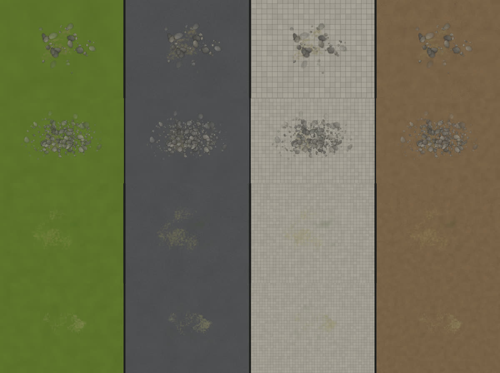
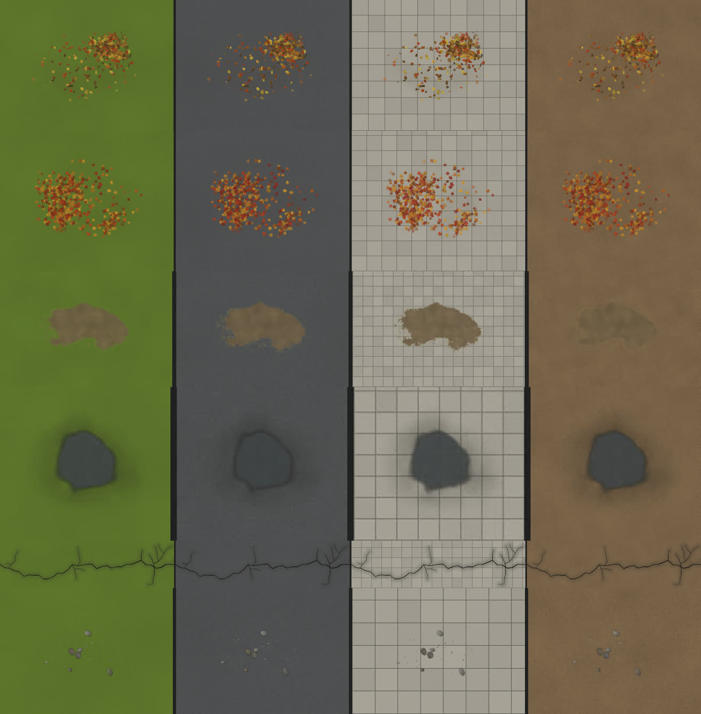
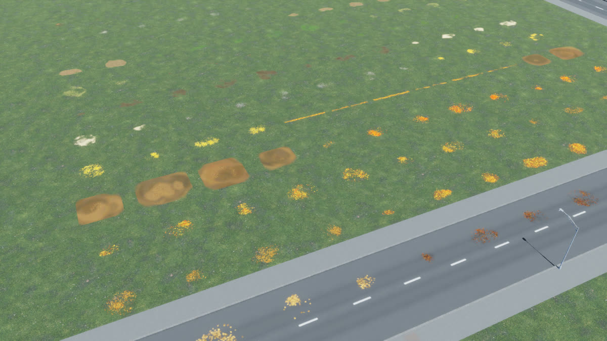

# Ground playbook: terrain paint, surfaces and decals

**Start with `docs/GROUND-RUNDOWN.md`** (the short how-to for any type, written after the sports park). This page is the
method and the user's art direction in full.

For the agent who makes a Placemaker type's ground look real: the sports park first, then every park, nature type,
plaza, car park and so on. It tells you how to plan the ground as one picture, which layer does what, how to grow the
decal library yourself, how to judge your work with the user, and what is still to build. Read it all once before you
touch anything; keep your own runbook as you go (section 9).

How the systems work inside: `docs/DYNAMIC-DECALS.md` (decals), `docs/TERRAIN-PAINT.md` (paint), `Core/Layers/Common/Lawn.cs`
(lawn: painted terrain or grass surface). This page is how to use them well.

## 1. What the user wants (their words, 2026-10-29)

- **"An artistic vision from top to bottom."** Terrain paint, surfaces and decals are planned together, in one go, as
  one picture. Not three passes by three habits.
- **Large.** Parks are seen from hundreds of feet up in the editor and about 100 feet up in play. A patch is 8-20 m.
  Pieces (leaves, stones) are drawn a little bigger than life so they read from there.
- **See-through, faded edges, organic, overlapping.** "Large but transparent, faded edges." Never a hard outline, never
  a solid blob, never anything robotic: no grids, no even spacing, no one-patch-per-object.
- **Smother or vary; never a blotch.** "If we're going to do any amount of birch leaves, it should be smothered in birch
  leaves." One lonely patch of leaves, four stones, one cluster of cigarette butts all read as mistakes. Small details
  must be consistent across the whole site, which means many instances.
- **Cater to what the game shows best.** Decals mostly add texture "when you're blurring your eye and looking at the
  thing as a whole", through a macro lens; each must still be an A+ up close. Pick big, readable things (leaf masses,
  bare ground, rock outcrops, worn paths, puddles, cracks) over tiny ones (pebbles, gum).
- **The library is examples, not a limit.** "Everything that's already there is basically just examples, but feel free
  to use it. Adding more basically takes no extra space to this mod." Make what your type needs (section 5).
- **Colour:** round 2's saturation was liked; every kind comes in full colour and one step toned down. Pick per site.
- **Grades so far:** library round 1 B-; the user's notes for each round are kept in sections 6 and 10.

## 2. The three ground layers and when to use which

| Layer | What it is | Use it for | Never for |
|---|---|---|---|
| **Terrain paint** | 4 vanilla materials (dry grass, forest floor, dirt, sand) painted into the city's splatmap, 3.5 m texels, soft (`Core/Paint`, `PaintKit`) | The soft base: lawn tone (moist/dry), transitions where the build meets the land, ground under trees, broad worn areas, beaches, infields | Anything under ~7 m, any edge, anything on paving or asphalt (paint only shows on bare terrain) |
| **Surfaces** (area prefabs) | A tiled material that hides the terrain inside a polygon (`ctx.Surface`, `SurfaceRole`) | Real hard or special materials only: courts, pitches with marked turf, paving, plazas, car parks, play surfaces | Whole-ground lawns. A grass surface is one uniform tile: no wear, no tone, no paint shows through it. **This is why the sports park looks plastic** |
| **Decals** (shared library) | Code-made textures drawn by the game's decal shader on top of everything (ground, surfaces, paths) | Everything with an edge or a shape: wear, seams, leaves, cracks, puddles, stones, litter, tone sheets over paving | Big uniform colour changes that paint can do for free |

**Order of thinking, top to bottom:**

1. **Ground choice.** Bare terrain + paint wherever the ground is "just grass" (the park around the sports parts, the
   verges, the edges). Surfaces only where a real material is (the courts, the pitch, the paths, the car park). Every
   lawn type has the choice `dressLawn` = Painted terrain / Grass surface (`Lawn.cs`); sports park, formal gardens,
   cemeteries and similar default to Grass surface today. The user's direction for the sports park: painted terrain for
   the park part, surfaces only for the sports parts. Changing a type's default is a design change: make it, see it in
   the game, tell the user.
2. **Paint the base.** Moisture and dryness over the whole lawn, forest floor under groups of trees, dirt where feet
   wear the ground broadly, dry grass halos, a soft transition at the build's outline (`GroundWear`, the Ground paint
   section). Paint is permanent (stays when a build is removed) and saved with the city.
3. **Surfaces for the hard parts.** Keep them crisp; the decals will soften their edges.
4. **Decals for the life.** Tone sheets over every lawn and paved area (faint), then causes (trees, feet, play, water,
   wheels, age), then seams, then signature flaws (section 4).

**How the layers meet at a boundary.** A surface edge is a hard line: put a strip decal along it (`pathEdgeWear` on the
grass side of a path, `seamGrime` along a court edge, `kerbGrimeStrip` against a kerb). Paint can't reach under the
surface, so paint the grass side up to the edge and let the decal cross the line by a metre either way. Decals lie on
terrain and surfaces alike (layer `terrain`) and on paths and roads (layer `roads`; kinds with `"layers": "ground"` do
both), so one decal can bridge the seam. Paint dirt under a `barePatch` decal and the two read as one ground.

## 3. What is ready and what is not (be clear about this)

**Ready to use:**

- **The shared library**: 65 kinds, 484 variants in 10 families (`Recipes/decals/library/*.json`), 131 MiB of GPU memory
  for all of them at once (budget 200 MiB). Patches, strips that repeat along their length, sheets that repeat both ways
  ("carpets"), chainable crack pieces; six fade types; two colour levels; macro/detail tiers.
- **The generator** (`Core/Decals/Dynamic`): data-only recipes, deterministic, worker threads, BC3. Section 5.
- **The game side for library instances** (`Game/Decals/SharedDecals.cs`): `SharedDecals.Place(id, owner, centre, yaw,
  scale, opacity)` draws an instance (one texture set per variant for the whole city, made on workers, disk cache in
  `ModsData/Placemaker/decal-cache/`, freed over budget, culled from 600 m, hidden in infoviews); `Clear(owner)`.
  Proven in the game with the lab: 388 instances, frame time 6.56 → 6.58 ms.
- **Terrain paint** (`Core/Paint`, `PaintKit`, `GroundWear`) and **surfaces**: mature, used by every type.
- **v1 strokes** (`kinds.json`, `Weathering.cs`, `DynamicDecalSystem`): per-build textures from causes; only the
  community sports park uses them (`Weathering.Wants`), with the **Grime** slider (0-300 %, 12 languages). This is the
  old way (about 30 MB and 10 s per park); replace it, don't extend it.
- **The browser and the offline baker** (sections 5, 8), the lab scenario `suite/scenarios/lab-library.json`.

**Built by the sports park agent (2026-10-29, `docs/runbooks/sportsPark.md` has the details and file list):**

- **Instances in the plan**: `AreaPlan.DecalInstances` (`DecalInstance`: kind, variant, x, z, yaw, stretch x/z, opacity,
  cause), record codec v2 (18 bytes an instance, v1 still read), placed by `DynamicDecalSystem` under owner `g<group>`
  and cleared with the group. `DecalLibrary.EnsureCurrent()` reads the library for plans made before the game has.
- **End caps** for strips and crack chains: variant `100 + i` fades out toward +x, `200 + i` toward −x (the same
  pixels times a ragged ramp), so runs never stop in a hard cut. `DecalVariants.SpanOf/FootprintOf` size pieces
  without baking.
- **Brushes** (`Core/Decals/Dynamic/Brushes.cs`, tests in `GroundDesignTests`): `Scatter`, `Tone`, `EdgeStrip`,
  `CracksAlong`, `Fill`, `Under`, `At`. Strip side rule: `Side` +1 = heavy side (+z) on the left of travel; a CCW ring
  has its inside on the left; `Offset` moves toward the heavy side.
- **Boundary passes and causes**: `Weathering.cs` is now the sports park's ground design on brushes (tone, trees by
  species, wind drifts, seams, play, feet, water, wheels, objects). v1 strokes are no longer made; old saves still draw.
  A type that wants its own ground copies the pattern: a Scene that reads its plan, then brush calls per cause.
- **Soft tone patches**: `lawnTonePatch`, `pavingTonePatch`, `asphaltTonePatch`, `dirtTonePatch`. Sheets (`xy`) have a
  hard square edge when laid alone: lay the patch kinds with `Tone`.
- **Offline look**: `PM_WRITE_GROUND=1` with `GroundDesignTests` renders a plan's decals from above (seconds).

**Still open:**

1. **A shared scene reader.** Sports parks read their plan in `Weathering.Scene.Read` (paths, aisles, fences, surfaces
   by role, trees by species, goals, stands, benches, bins, bays, steel). The next type should lift it into its own
   class (`GroundScene`) rather than copy it, and give `Weathering.Wants` a per-type design.
2. **Speed of the design.** 30-500 ms per plan on a worker, and it runs on every preview re-plan; most of it is the
   cause fields of `Scatter` (each rejection sample tests the area's rings and holes). A grid mask per area would cut it.
3. **Player controls**: the Grime slider (12 languages) now holds for every sports park style; anything new the player
   reads goes into 12 languages (`node tools/lang/check.js`, AGENTS.md).

Build these once, generally, with tests; every later type reuses them.

### Lessons from the sports park (2026-10-29; details in `docs/runbooks/sportsPark.md`)

- **Frame time:** never a `MaterialPropertyBlock` per instance (0.7 µs per renderer: +1.6 ms for 2000). `SharedDecals`
  puts the size in the transform and the opacity in 8 shared step materials: 1528 instances cost 0.03-0.2 ms.
  `RenderMeshInstanced` draws nothing with CS2's DefaultDecal.
- **Draw order:** the game draws its surfaces (turf, paving) as decals at the template queue; library decals must draw
  above it or they vanish under the turf (`SharedDecals` does this for every kind).
- **The look:** macro soft patches read as smudges from the player's height: faint and few. Detail is crisp and speckled.
  Leaves follow the trees' species and the season. Dirt is grit, not mud. A seam strip must know its far side.
- **One look first:** paint moisture (`GroundWear.LawnMoisture`), leaf colour (`Weathering.Season`), crack kind by
  material, colour level by formality: decide them before any brush runs.

## 4. The method for a type

1. **Read the type** in the game first (`tools/suite/Show.ps1 -Type <type> -Style all`): what is grass, what is hard,
   where people go, where trees stand, where water sits, what the edges are.
2. **Choose the ground** (section 2, step 1) and the paint base.
3. **List the causes** and what each lays down:

| Cause | Ask | Library kinds |
|---|---|---|
| Trees | Which species, how many, which way does the wind blow? | `leaf…` patches downwind, `…Carpet` under groups, `woodlandFloor`, `pineNeedlesCarpet`, `blossomPetals` |
| Feet | Where do people walk, wait, cut corners, bunch up? | `wornPath`, `barePatch`, `pathEdgeWear`, `litterSprinkle` |
| Play | Goals, courts, swings, stands, dugouts? | `barePatch` (goalmouths), `mudPatch`, `sandSpill` (courts), `grassClippings` (detail) |
| Water | Low points, paths, car parks, after rain? | `puddlePiece` (overlap pieces), `dampPatch`, `dryTidemark` |
| Wheels | Car parks, service tracks, mower routes? | `tyreTrack`, `skidMark`, `oilSpot`, `wheelRut` |
| Age | Asphalt, concrete, kerbs, fences, steel? | `crackAsphalt`/`crackConcrete`/`crackSealed` chains, `crackWeb`, `potholePatch`, `kerbGrimeStrip`, `fenceLine`, `seamGrime`, `mossPatch` |
| Wildness | Rough corners, slopes, the edge of the land | `rockOutcrop`, `stonesCarpet`, `groundMottle`, `dryGrass` |
| Everything | Every open lawn and paved area | `lawnTone`, `mowingStripes`, `groundMottle`, `asphaltSheet`, `pavingTone`, `dirtTone` |

4. **Seams**: every boundary gets a strip (section 2, "How the layers meet").
5. **Signature flaws**: each site exaggerates one or two things a visitor would remember: the bald goalmouth, the big
   puddle in the low corner, the leaf-choked corner, the shortcut to the bus stop. 1-4 strong spots per site.
6. **Density and strength targets:**
   - tone sheets over **every** open lawn and paved area, faint (5-12 % change): no swath untouched;
   - cause-driven kinds cover what their cause reaches: carpets where the cause is everywhere (a grove), patches on top
     where it is local (one tree, one gate);
   - small things thin but even over their whole area, never one cluster;
   - from the player's view the site reads as lived-in but calm; up close every patch holds up.
7. **Colour level**: formal or quiet sites use the toned-down variants (odd indices); autumn woodland and wild corners
   the full-colour ones (even indices). Mix within one site only with a reason.

## 5. Growing the library (you are expected to)

Everything in the library is an example. Add kinds, add variants, change recipes: data only, near zero cost.

- **Cost**: nothing in the mod package (recipes are a few hundred bytes of JSON); the textures are made on the player's
  machine on first use, cached on disk, and only the variants a city uses go on the GPU. All 484 variants together are
  131 MiB; the budget is 200 MiB city-wide and unused variants are freed. Prefer larger texels for macro kinds (3-7 cm:
  that's what the player sees from 30-100 m) and you can afford 8-16 variants per kind.
- **Where**: `Recipes/decals/library/<family>.json`. Add a family file if nothing fits. Each kind: `id`, `name`, `tier`
  (`macro` | `detail`), `about`, `texel`, `layers`, `order`, `lod`, `maxTexels`, `opacity`, `edge`, `variants`, `ops`.
  `variants`: `count`, `size`, `aspect` or `width`, `strength`/`wet`/`age` ranges, `tile` (`none` | `x` | `xy` |
  `chain`), `fades` (`soft`, `linear`, `side`, `ring`, `islands`, `wide`), `saturations` (the family gives `[1, 0.8]`).
  Ops and stamps: `docs/DYNAMIC-DECALS.md` (noise, warp, cells, waves, erosion, cracks with T-junctions and chains,
  cluster scatter, trails, 20 stamp shapes, colour layers with wetness, height and gloss).
- **A whole new look** usually needs only recipes; a new stamp shape or op is a small change in `DecalGenerator.cs`
  (add a test; bump `DecalVariants.GeneratorVersion` when existing pixels change, so disk caches refresh).
- **Rules for a good kind**: large and see-through (`opacity` 0.5-0.9; water and tone lower), soft fading edges, varied
  variants (fades, sizes, colour levels), a `…Carpet` sheet if the look should cover areas, colours near the game's own
  (`docs/TERRAIN-PAINT.md` §3 has the terrain's measured colours).
- **See it**: `PM_BAKE_LIBRARY=1 PM_BAKE_ONLY=<kind or family> dotnet test Tests/Placemaker.Tests --filter DecalLibraryTests`
  writes `.forensics/decals/library/img/<kind>-<n>.png` (each variant on grass, asphalt, paving and dirt, lit like the
  game) and `manifest.json`. Look at every variant yourself; contact sheets with ffmpeg help (`vstack`).
- **Test it**: `dotnet test Tests/Placemaker.Tests --filter "DecalLibraryTests|DynamicDecalsTests"`: families read,
  variants deterministic, strips and sheets repeat without a seam, chains join, the whole library fits the budget.
- **Show it**: republish the browser (section 8) and ask the user.
- **Check it in the game**: `suite/scenarios/lab-library.json` lays every kind on a field (lab op `library`, `"kinds"`
  takes ids or family names, `"focus"` frames one); the type's own build with `Show.ps1` once brushes exist.

## 6. The library's history (what the user said, what changed)

| Round | User's verdict | What changed |
|---|---|---|
| v1 (strokes, per park) | C-: blobs, same speckle, hard puddle ring, worm prints, untouched lawns | replaced by the shared library |
| 1 (54 kinds) | B-: leaves are A, everything else "larger, more transparent, more variation"; puddle = oil stain; dry leaves = a stain; pine needles a blob; acorns pointless; tyre tracks = railway | 2× sizes, `opacity`, fade types, carpets, woodland floor, chevron tyre tread |
| 2 (62 kinds) | "even larger, saturation toned down, organic, overlapping, high transparency, never robotic" | 1.5× sizes, two colour levels, ragged fades |
| 3 (65 kinds, 484 variants) | "cater to what the game shows best" (seen from 100+ ft); many variations so a park never repeats | macro/detail tiers, view-distance texels, 8-16 variants, rock outcrop, worn path, ground mottle |

## 7. Placing: never robotic

Brushes (and anything that places instances) must:

- **Overlap.** Patches overlap each other and other kinds (leaves over bare ground over tone); edges blend because
  every kind fades over metres. Never butt patches edge to edge or leave even gaps.
- **No grids, no even spacing.** Positions from the cause (wind shadow, foot traffic, low ground) plus a cluster
  process: clumps of clumps, thinning away from the cause. Neighbours never the same variant; any rotation for
  patches, ±10° along the line for strips; scale 0.7-1.4; opacity 0.6-1.0.
- **Follow the ground's shapes.** Leaves pile against kerbs and fences downwind, wear follows the walking line and
  widens where people bunch, puddles sit in the real hollows (the built heightmap), cracks follow the road.
- **Mix where causes mix.** Under a mixed group of trees: mixed leaves, woodland floor and a little bare ground,
  overlapping; not three tidy patches.
- **Carpets for "everywhere", patches for "here".** A carpet alone looks like wallpaper; patches alone like blotches.
- **Strips end to end along seams**, cut at corners; crack chains end to end along a road (their main crack enters
  and leaves at the middle of each short side).
- **Judge from the player's distance.** If it reads as a pattern from 100 m up, it is wrong.

## 8. The loop with the user

1. **Your own eyes first.** Offline renders for kinds, the game runner for builds. Never tell the user anything you
   have not seen.
2. **The game runner** (AGENTS.md, `suite/README.md`): `tools/suite/Show.ps1` and `Send-Suite.ps1` always as a
   **background** command with `-Who <your task>`, never `-AllMods`, never `-Direct`. The user's own game blocks the
   queue ("waiting: the user's own game is open"): that can take an hour, it's fine, do other work. A new worktree needs
   the shared UI deps linked (`cmd /c mklink /J <wt>\UI\node_modules C:\Users\jack\cs2-area-tool\UI\node_modules`) or
   the build fails ("UI dependencies missing"). Look from 45° with the whole site in view first, close-ups second.
3. **The browser**: https://claude.ai/artifact/BTMZX1HfRAhjkRHdCBzJCN shows every variant on four grounds, settings in
   plain words, Good/Bad + note per variant, Keep/Drop + note per kind, suggested settings. Its store (read it with
   the artifact data tool): collections `marks` (doc id `kind-index`), `kinds` (doc id = kind), `suggestions`.
   Republish: bake, convert pictures to JPEG (`ffmpeg -q:v 4`), copy `manifest.json` next to the page, publish the
   page with the changed pictures at the same URL (at most 255 files per publish: split the list). The page itself
   lives in the lead session's scratchpad; ask for it, or read it back with the Artifact tool.
4. **The user also reviews in plain words**, often by voice, often mid-task. Act on the sentiment, not only the letter:
   "the puddle looks like oil" means water must be see-through everywhere. Write their words into your runbook.
5. **Report**: what you saw in the game, with pictures (SendUserFile), and what is not installed ("fixed on branch X and
   seen in the game runner; not in your game yet"). You never install; the lead does.

## 9. Your runbook (keep one per type)

Each type gets `docs/runbooks/<type>.md`, built as you work so the next agent starts where you stopped. Copy
`docs/runbooks/TEMPLATE.md`. Keep it short and true: the ground plan, the causes and kinds you used, the numbers
(density, opacity, counts), what the user said and graded, the runs that prove it, what failed and why, what's left.
When you learn something that holds for every type, put it here in the playbook too.

## 10. Never break these (removal and safety)

- Decals are GameObjects with `HideAndDontSave`: never entities, never a `PrefabRef`, never a prefab, never a pack decal.
- A save holds only Placemaker's own record data (strokes, later instances or brush calls). Without the mod the game
  skips that component and drops the record: nothing is left behind.
- The disk cache is a pure cache: deleting `ModsData/Placemaker/decal-cache/` costs only regeneration time.
- Terrain paint is vanilla city data: it stays when a build is removed (say so in the review, as today).
- Memory: game boots failed earlier from out-of-memory caused by leaked `.unity\relay\relay_win.exe` processes. If a
  boot fails with "Out of memory" in Player.log, check commit memory (`Get-CimInstance Win32_OperatingSystem`,
  FreeVirtualMemory) and report it rather than retrying.
- Known bug in the sports park (not decals, but in the same pictures): tennis and volleyball nets are not turned 90°
  (they run along the court instead of across it) and some props stand backwards: `Core/Layers/AddOns/Fields/SportsProps.cs`
  and the court code, every court type.

## 11. Log of types done

| Type | Date | Agent's runbook | Grade | Notes |
|---|---|---|---|---|
| Library rounds 1-3 | 2026-10-29 | (this page, section 6) | B- after round 1 | 65 kinds, 484 variants, 131 MiB |
| Sports park | 2026-10-29 | `docs/runbooks/sportsPark.md` | B+ (then B− for smudge, fixed) | first type on the shared library; built instances, codec v2, end caps, brushes, boundary passes; every style |
| Rundown (abandoned lot, construction site, urban ruins) | 2026-10-30 | `docs/runbooks/rundown.md` | not graded | own category; grounds laid from the layer (RundownGround), rundown family (9 kinds), paint slot 3 for earth |
